# System Design Document (CLSMS Web Application)

> **Document:** Architecture, Domain Model, Service Contracts & REST API Design  
> **Version:** 2.0 (Web Application Architecture)  
> **Target Audience:** Beginner to Intermediate Student Development Team  
> **Source PRD:** [docs/PRD.md](file:///c:/Users/HP/Desktop/Schedule%20WebApp/docs/PRD.md)  
> **Project Rules:** [PROJECT_RULES.md](file:///c:/Users/HP/Desktop/Schedule%20WebApp/PROJECT_RULES.md)

---

## 1. Class Diagram

The following Mermaid diagram specifies the domain entities, utilities, service dependencies, and their composition relationships. Model, service, and util classes are pure Java (no Spring annotations, no HTTP code).

```mermaid
classDiagram
    direction TB

    %% Enumerations
    class RoomType {
        <<enumeration>>
        CLASSROOM
        LABORATORY
    }

    %% Model Entities
    class Room {
        -String roomId
        -String name
        -RoomType type
        -String location
        -int capacity
        -String description
        -boolean active
        +getRoomId() String
        +getName() String
        +getType() RoomType
        +getLocation() String
        +getCapacity() int
        +getDescription() String
        +isActive() boolean
        +setName(String name) void
        +setType(RoomType type) void
        +setLocation(String location) void
        +setCapacity(int capacity) void
        +setDescription(String description) void
        +setActive(boolean active) void
    }

    class Course {
        -String courseCode
        -String title
        -int expectedEnrollment
        -RoomType requiredRoomType
        -String department
        -String section
        +getCourseCode() String
        +getTitle() String
        +getExpectedEnrollment() int
        +getRequiredRoomType() RoomType
        +getDepartment() String
        +getSection() String
        +setTitle(String title) void
        +setExpectedEnrollment(int expectedEnrollment) void
        +setRequiredRoomType(RoomType requiredRoomType) void
        +setDepartment(String department) void
        +setSection(String section) void
    }

    class Instructor {
        -String instructorId
        -String fullName
        -String department
        -String email
        -String phone
        +getInstructorId() String
        +getFullName() String
        +getDepartment() String
        +getEmail() String
        +getPhone() String
        +setFullName(String fullName) void
        +setDepartment(String department) void
        +setEmail(String email) void
        +setPhone(String phone) void
    }

    class Schedule {
        -String scheduleId
        -Course course
        -Instructor instructor
        -Room room
        -DayOfWeek day
        -LocalTime startTime
        -LocalTime endTime
        +getScheduleId() String
        +getCourse() Course
        +getInstructor() Instructor
        +getRoom() Room
        +getDay() DayOfWeek
        +getStartTime() LocalTime
        +getEndTime() LocalTime
        +setCourse(Course course) void
        +setInstructor(Instructor instructor) void
        +setRoom(Room room) void
        +setDay(DayOfWeek day) void
        +setTimeInterval(LocalTime startTime, LocalTime endTime) void
    }

    %% Utility Classes
    class ValidationResult {
        -boolean valid
        -List~String~ errors
        +success()$ ValidationResult
        +failure(List~String~ errors)$ ValidationResult
        +failure(String singleError)$ ValidationResult
        +isValid() boolean
        +getErrors() List~String~
        +addError(String error) void
        +addErrors(List~String~ errors) void
        +getFormattedErrors() String
    }

    class TimeUtil {
        +overlaps(LocalTime newStart, LocalTime newEnd, LocalTime existingStart, LocalTime existingEnd)$ boolean
        +parseTime(String timeString)$ LocalTime
        +parseDay(String dayString)$ DayOfWeek
        +formatTime(LocalTime time)$ String
    }

    %% Service Classes
    class ConflictChecker {
        +checkAllConflicts(Schedule candidate, List~Schedule~ existingSchedules, String excludeScheduleId) ValidationResult
        +checkRoomConflict(Schedule candidate, List~Schedule~ existingSchedules, String excludeScheduleId) ValidationResult
        +checkInstructorConflict(Schedule candidate, List~Schedule~ existingSchedules, String excludeScheduleId) ValidationResult
        +checkCapacity(Room room, Course course) ValidationResult
        +checkRoomTypeSuitability(Room room, Course course) ValidationResult
    }

    class RoomManager {
        -List~Room~ roomList
        -Map~String, Room~ roomMap
        -ScheduleReferenceChecker scheduleReferenceChecker
        +addRoom(String roomId, String name, RoomType type, String location, int capacity, String description) ValidationResult
        +getRoomById(String roomId) Optional~Room~
        +getAllRooms() List~Room~
        +searchRooms(String query) List~Room~
        +updateRoom(String roomId, String name, RoomType type, String location, int capacity, String description, boolean active) ValidationResult
        +deleteRoom(String roomId) ValidationResult
        +setScheduleReferenceChecker(ScheduleReferenceChecker checker) void
    }

    class CourseManager {
        -List~Course~ courseList
        -Map~String, Course~ courseMap
        -ScheduleReferenceChecker scheduleReferenceChecker
        +addCourse(String courseCode, String title, int expectedEnrollment, RoomType requiredRoomType, String department, String section) ValidationResult
        +getCourseByCode(String courseCode) Optional~Course~
        +getAllCourses() List~Course~
        +searchCourses(String query) List~Course~
        +updateCourse(String courseCode, String title, int expectedEnrollment, RoomType requiredRoomType, String department, String section) ValidationResult
        +deleteCourse(String courseCode) ValidationResult
        +setScheduleReferenceChecker(ScheduleReferenceChecker checker) void
    }

    class InstructorManager {
        -List~Instructor~ instructorList
        -Map~String, Instructor~ instructorMap
        -ScheduleReferenceChecker scheduleReferenceChecker
        +addInstructor(String instructorId, String fullName, String department, String email, String phone) ValidationResult
        +getInstructorById(String instructorId) Optional~Instructor~
        +getAllInstructors() List~Instructor~
        +searchInstructors(String query) List~Instructor~
        +updateInstructor(String instructorId, String fullName, String department, String email, String phone) ValidationResult
        +deleteInstructor(String instructorId) ValidationResult
        +setScheduleReferenceChecker(ScheduleReferenceChecker checker) void
    }

    class ScheduleManager {
        -List~Schedule~ scheduleList
        -Map~String, Schedule~ scheduleMap
        -ConflictChecker conflictChecker
        -RoomManager roomManager
        -CourseManager courseManager
        -InstructorManager instructorManager
        -int nextSequence
        +createSchedule(String courseCode, String instructorId, String roomId, DayOfWeek day, LocalTime startTime, LocalTime endTime) ValidationResult
        +updateSchedule(String scheduleId, String courseCode, String instructorId, String roomId, DayOfWeek day, LocalTime startTime, LocalTime endTime) ValidationResult
        +cancelSchedule(String scheduleId) ValidationResult
        +getScheduleById(String scheduleId) Optional~Schedule~
        +getAllSchedules() List~Schedule~
        +searchSchedules(String roomId, String courseCode, String instructorId, DayOfWeek day, LocalTime time) List~Schedule~
        +findAvailableRooms(DayOfWeek day, LocalTime startTime, LocalTime endTime, Integer minCapacity, RoomType requiredType) List~Room~
        +isRoomReferenced(String roomId) boolean
        +isCourseReferenced(String courseCode) boolean
        +isInstructorReferenced(String instructorId) boolean
    }

    class ReportManager {
        -ScheduleManager scheduleManager
        -RoomManager roomManager
        -CourseManager courseManager
        -InstructorManager instructorManager
        +getDailyTimetable(DayOfWeek day) List~Schedule~
        +getRoomTimetable(String roomId) Map~DayOfWeek, List~Schedule~~
        +getInstructorTimetable(String instructorId) Map~DayOfWeek, List~Schedule~~
        +getSystemSummary() Map~String, Object~
    }

    %% Relationships
    Room *-- RoomType : has
    Schedule *-- Room : composition
    Schedule *-- Course : composition
    Schedule *-- Instructor : composition

    ConflictChecker ..> TimeUtil : calls overlaps()
    ConflictChecker ..> ValidationResult : returns

    ScheduleManager --> ConflictChecker : delegates validation
    ScheduleManager --> RoomManager : retrieves rooms
    ScheduleManager --> CourseManager : retrieves courses
    ScheduleManager --> InstructorManager : retrieves instructors
    ScheduleManager ..> ValidationResult : returns

    ReportManager --> ScheduleManager : queries schedules
    ReportManager --> RoomManager : queries rooms
```



---

## 2. Fields with Types and Visibility for Every Class

All fields across all classes adhere strictly to encapsulation: **every field is private**.

### 2.1 Model Package (`model`)

#### `RoomType` (Enum)
- Values: `CLASSROOM`, `LABORATORY`

#### `Room`
- `private final String roomId` — Unique uppercase identifier (e.g. `"C-101"`).
- `private String name` — Room name/number (e.g. `"Lecture Hall 1"`).
- `private RoomType type` — Room type enum (`CLASSROOM` or `LABORATORY`).
- `private String location` — Building and floor (e.g. `"Main Building – 1st Floor"`).
- `private int capacity` — Occupancy limit (must be $> 0$).
- `private String description` — Optional notes/equipment (defaults to `""`).
- `private boolean active` — Operational state (defaults to `true`).

#### `Course`
- `private final String courseCode` — Unique uppercase identifier (e.g. `"CS201"`).
- `private String title` — Course title (e.g. `"Object-Oriented Programming"`).
- `private int expectedEnrollment` — Student count (must be $> 0$).
- `private RoomType requiredRoomType` — Required room type (nullable; `null` means any type).
- `private String department` — Academic department (optional, defaults to `""`).
- `private String section` — Section designation (optional, defaults to `""`).

#### `Instructor`
- `private final String instructorId` — Unique uppercase identifier (e.g. `"I-001"`).
- `private String fullName` — Faculty name (e.g. `"Dr. Jane Doe"`).
- `private String department` — Academic department (optional, defaults to `""`).
- `private String email` — Contact email (optional, defaults to `""`).
- `private String phone` — Contact phone (optional, defaults to `""`).

#### `Schedule`
- `private final String scheduleId` — Unique auto-generated ID (e.g. `"S-001"`).
- `private Course course` — Composition reference to `Course`.
- `private Instructor instructor` — Composition reference to `Instructor`.
- `private Room room` — Composition reference to `Room`.
- `private DayOfWeek day` — Scheduled day of the week.
- `private LocalTime startTime` — 24-hour start time.
- `private LocalTime endTime` — 24-hour end time (strictly after `startTime`).

---

### 2.2 Utility Package (`util`)

#### `ValidationResult`
- `private final boolean valid` — Status flag (`true` if valid, `false` if errors exist).
- `private final List<String> errors` — Accumulated list of error messages.

#### `TimeUtil`
- Utility class with private constructor; no instance fields.
- `private static final DateTimeFormatter TIME_FORMATTER = DateTimeFormatter.ofPattern("HH:mm");`

---

### 2.3 Service Package (`service`)

#### `ConflictChecker`
- Stateless service class; no mutable instance fields.

#### `RoomManager`
- `private final List<Room> roomList` — Preserves creation and display order.
- `private final Map<String, Room> roomMap` — Keyed by normalized uppercase `roomId` for $O(1)$ lookups.
- `private ScheduleReferenceChecker scheduleReferenceChecker` — Reference checker interface.

#### `CourseManager`
- `private final List<Course> courseList` — Preserves creation and display order.
- `private final Map<String, Course> courseMap` — Keyed by normalized uppercase `courseCode`.
- `private ScheduleReferenceChecker scheduleReferenceChecker` — Reference checker interface.

#### `InstructorManager`
- `private final List<Instructor> instructorList` — Preserves creation and display order.
- `private final Map<String, Instructor> instructorMap` — Keyed by normalized uppercase `instructorId`.
- `private ScheduleReferenceChecker scheduleReferenceChecker` — Reference checker interface.

#### `ScheduleManager`
- `private final List<Schedule> scheduleList` — In-memory list of active schedules.
- `private final Map<String, Schedule> scheduleMap` — Keyed by `scheduleId`.
- `private final ConflictChecker conflictChecker` — Injected conflict validator.
- `private final RoomManager roomManager` — Reference to look up rooms.
- `private final CourseManager courseManager` — Reference to look up courses.
- `private final InstructorManager instructorManager` — Reference to look up instructors.
- `private int nextSequence` — Internal counter for generating IDs (`S-001`, `S-002`, ...).

#### `ReportManager`
- `private final ScheduleManager scheduleManager` — Source for schedule records.
- `private final RoomManager roomManager` — Source for room counts.
- `private final CourseManager courseManager` — Source for course counts.
- `private final InstructorManager instructorManager` — Source for instructor counts.

---

## 3. Exact Service Method Signatures

All operations that can fail validation return `ValidationResult` containing all collected error messages.

### 3.1 `ConflictChecker`
```java
package service;

import model.Course;
import model.Room;
import model.Schedule;
import util.ValidationResult;
import java.util.List;

public class ConflictChecker {

    /**
     * Checks all conflict categories (room overlap, instructor overlap, capacity, room type) and aggregates all errors.
     */
    public ValidationResult checkAllConflicts(Schedule candidate, List<Schedule> existingSchedules, String excludeScheduleId);

    /**
     * Checks if another active booking uses the same room on the same day during an overlapping interval.
     */
    public ValidationResult checkRoomConflict(Schedule candidate, List<Schedule> existingSchedules, String excludeScheduleId);

    /**
     * Checks if another active booking assigns the same instructor on the same day during an overlapping interval.
     */
    public ValidationResult checkInstructorConflict(Schedule candidate, List<Schedule> existingSchedules, String excludeScheduleId);

    /**
     * Validates that room capacity is greater than or equal to course expected enrollment.
     */
    public ValidationResult checkCapacity(Room room, Course course);

    /**
     * Validates that room type matches the course's required room type (if specified).
     */
    public ValidationResult checkRoomTypeSuitability(Room room, Course course);
}
```

### 3.2 `RoomManager`
```java
package service;

import model.Room;
import model.RoomType;
import util.ValidationResult;
import java.util.List;
import java.util.Optional;

public class RoomManager {

    /**
     * Validates fields, checks for duplicate roomId, and stores a new active Room record.
     */
    public ValidationResult addRoom(String roomId, String name, RoomType type, String location, int capacity, String description);

    /**
     * Finds and returns an Optional containing the Room matching the given roomId, or empty if not found.
     */
    public Optional<Room> getRoomById(String roomId);

    /**
     * Returns an unmodifiable list of all registered rooms in insertion order.
     */
    public List<Room> getAllRooms();

    /**
     * Performs a case-insensitive partial match search on room ID, name, or location.
     */
    public List<Room> searchRooms(String query);

    /**
     * Validates updated fields and atomically modifies the existing Room if valid, leaving it unchanged on failure.
     */
    public ValidationResult updateRoom(String roomId, String name, RoomType type, String location, int capacity, String description, boolean active);

    /**
     * Deletes the room if unreferenced, or deactivates it if referenced by an active schedule.
     */
    public ValidationResult deleteRoom(String roomId);

    /**
     * Injects a reference checker interface so deletion can verify active schedule references before ScheduleManager exists.
     */
    public void setScheduleReferenceChecker(ScheduleReferenceChecker checker);
}
```

### 3.3 `CourseManager`
```java
package service;

import model.Course;
import model.RoomType;
import util.ValidationResult;
import java.util.List;
import java.util.Optional;

public class CourseManager {

    /**
     * Validates fields, checks for duplicate courseCode, and stores a new Course record.
     */
    public ValidationResult addCourse(String courseCode, String title, int expectedEnrollment, RoomType requiredRoomType, String department, String section);

    /**
     * Finds and returns an Optional containing the Course matching the courseCode, or empty if not found.
     */
    public Optional<Course> getCourseByCode(String courseCode);

    /**
     * Returns an unmodifiable list of all registered courses in insertion order.
     */
    public List<Course> getAllCourses();

    /**
     * Performs a case-insensitive partial match search on course code, title, or department.
     */
    public List<Course> searchCourses(String query);

    /**
     * Validates updated fields and atomically modifies the existing Course if valid, leaving it unchanged on failure.
     */
    public ValidationResult updateCourse(String courseCode, String title, int expectedEnrollment, RoomType requiredRoomType, String department, String section);

    /**
     * Deletes the course if unreferenced; blocks deletion and returns an explanatory error if referenced by any schedule.
     */
    public ValidationResult deleteCourse(String courseCode);

    /**
     * Injects a reference checker interface so deletion can verify active schedule references.
     */
    public void setScheduleReferenceChecker(ScheduleReferenceChecker checker);
}
```

### 3.4 `InstructorManager`
```java
package service;

import model.Instructor;
import util.ValidationResult;
import java.util.List;
import java.util.Optional;

public class InstructorManager {

    /**
     * Validates fields, checks for duplicate instructorId, and stores a new Instructor record.
     */
    public ValidationResult addInstructor(String instructorId, String fullName, String department, String email, String phone);

    /**
     * Finds and returns an Optional containing the Instructor matching the instructorId, or empty if not found.
     */
    public Optional<Instructor> getInstructorById(String instructorId);

    /**
     * Returns an unmodifiable list of all registered instructors in insertion order.
     */
    public List<Instructor> getAllInstructors();

    /**
     * Performs a case-insensitive partial match search on instructor ID, name, or department.
     */
    public List<Instructor> searchInstructors(String query);

    /**
     * Validates updated fields and atomically modifies the existing Instructor if valid, leaving it unchanged on failure.
     */
    public ValidationResult updateInstructor(String instructorId, String fullName, String department, String email, String phone);

    /**
     * Deletes the instructor if unreferenced; blocks deletion and returns an explanatory error if referenced by any schedule.
     */
    public ValidationResult deleteInstructor(String instructorId);

    /**
     * Injects a reference checker interface so deletion can verify active schedule references.
     */
    public void setScheduleReferenceChecker(ScheduleReferenceChecker checker);
}
```

### 3.5 `ScheduleManager`
```java
package service;

import model.Room;
import model.RoomType;
import model.Schedule;
import util.ValidationResult;
import java.time.DayOfWeek;
import java.time.LocalTime;
import java.util.List;
import java.util.Optional;

public class ScheduleManager {

    /**
     * Validates existence of entities, time order, capacity, room type, and conflicts before creating a schedule with an auto-generated ID.
     */
    public ValidationResult createSchedule(String courseCode, String instructorId, String roomId, DayOfWeek day, LocalTime startTime, LocalTime endTime);

    /**
     * Re-validates the schedule modification excluding its own ID from conflict checks, updating atomically on success.
     */
    public ValidationResult updateSchedule(String scheduleId, String courseCode, String instructorId, String roomId, DayOfWeek day, LocalTime startTime, LocalTime endTime);

    /**
     * Cancels and permanently removes the schedule entry matching the scheduleId.
     */
    public ValidationResult cancelSchedule(String scheduleId);

    /**
     * Finds and returns an Optional containing the Schedule matching the scheduleId, or empty if not found.
     */
    public Optional<Schedule> getScheduleById(String scheduleId);

    /**
     * Returns all active schedules sorted chronologically by day of week and start time.
     */
    public List<Schedule> getAllSchedules();

    /**
     * Filters active schedules by any non-null combination of roomId, courseCode, instructorId, day, and time.
     */
    public List<Schedule> searchSchedules(String roomId, String courseCode, String instructorId, DayOfWeek day, LocalTime time);

    /**
     * Finds active rooms free throughout the requested interval that meet optional capacity and type criteria.
     */
    public List<Room> findAvailableRooms(DayOfWeek day, LocalTime startTime, LocalTime endTime, Integer minCapacity, RoomType requiredType);

    /**
     * Returns true if any active schedule references the specified room ID.
     */
    public boolean isRoomReferenced(String roomId);

    /**
     * Returns true if any active schedule references the specified course code.
     */
    public boolean isCourseReferenced(String courseCode);

    /**
     * Returns true if any active schedule references the specified instructor ID.
     */
    public boolean isInstructorReferenced(String instructorId);
}
```

### 3.6 `ReportManager`
```java
package service;

import model.Schedule;
import java.time.DayOfWeek;
import java.util.List;
import java.util.Map;

public class ReportManager {

    /**
     * Returns all bookings for a given day sorted in ascending order of start time.
     */
    public List<Schedule> getDailyTimetable(DayOfWeek day);

    /**
     * Returns all bookings for a specific room grouped by day of week in chronological order.
     */
    public Map<DayOfWeek, List<Schedule>> getRoomTimetable(String roomId);

    /**
     * Returns all bookings for a specific instructor grouped by day of week in chronological order.
     */
    public Map<DayOfWeek, List<Schedule>> getInstructorTimetable(String instructorId);

    /**
     * Computes aggregate summary counts (total rooms, classrooms, laboratories, active schedules).
     */
    public Map<String, Object> getSystemSummary();
}
```

---

## 4. ID Rules & Identification Standards

| Entity | ID Field | Formatted Example | Input Source | Generation & Validation Rules |
| :--- | :--- | :--- | :--- | :--- |
| **Room** | `roomId` | `"C-101"`, `"L-01"` | User Input | Non-blank, trimmed, normalized to uppercase. Unique across rooms. Example pattern: `[A-Z0-9-]+`. |
| **Course** | `courseCode` | `"CS201"`, `"PHY210"` | User Input | Non-blank, trimmed, normalized to uppercase. Unique across courses. Example pattern: `[A-Z0-9-]+`. |
| **Instructor** | `instructorId` | `"I-001"`, `"I-012"` | User Input | Non-blank, trimmed, normalized to uppercase. Unique across instructors. Standard prefix: `I-` + digits. |
| **Schedule** | `scheduleId` | `"S-001"`, `"S-002"` | **System Auto-generated** | Automatically assigned on successful creation using `String.format("S-%03d", nextSequence++)`. Read-only. |

---

## 5. Deletion & Referential Integrity Rules

When an entity is referenced by one or more active schedules:

1. **Room Deletion (`deleteRoom`):**
   - If the room is **not referenced**, it is permanently removed from `roomList` and `roomMap`.
   - If the room **is referenced by active schedules**, it is **deactivated** (`room.setActive(false)`) instead of removed. Existing bookings remain intact for historical records and timetables, but the room is excluded from `findAvailableRooms` and cannot be booked in new schedules. The operation succeeds with a notification: `"Room C-101 has active bookings and was deactivated instead of removed."`
2. **Course Deletion (`deleteCourse`):**
   - If the course is **not referenced**, it is removed from `courseList` and `courseMap`.
   - If the course **is referenced by active schedules**, deletion is **blocked**. The operation fails, leaving data unchanged, and returns `ValidationResult.failure("Cannot delete Course 'CS201': It is referenced by active schedule(s). Cancel associated bookings first.")`.
3. **Instructor Deletion (`deleteInstructor`):**
   - If the instructor is **not referenced**, they are removed from `instructorList` and `instructorMap`.
   - If the instructor **is referenced by active schedules**, deletion is **blocked**. The operation fails, leaving data unchanged, and returns `ValidationResult.failure("Cannot delete Instructor 'I-001': Instructor is assigned to active schedule(s). Reassign or cancel associated bookings first.")`.
4. **Decoupled Reference Checking via Interface:**
   - To keep `RoomManager`, `CourseManager`, and `InstructorManager` testable before `ScheduleManager` is implemented, they use a simple functional interface:
     ```java
     package service;
     @FunctionalInterface
     public interface ScheduleReferenceChecker {
         boolean isReferenced(String entityId);
     }
     ```
   - When `ScheduleManager` is created in Step 5, its query methods (`isRoomReferenced`, etc.) plug into this interface seamlessly.

---

## 6. REST API Design

### 6.1 Endpoints Table

| Method | Endpoint Path | Purpose | Request Body | Success Status |
| :--- | :--- | :--- | :--- | :--- |
| `GET` | `/api/rooms` | List all rooms (optional `?search=query`) | None | `200 OK` |
| `GET` | `/api/rooms/{id}` | Get a single room by ID | None | `200 OK` |
| `POST` | `/api/rooms` | Create a new room | RoomDTO | `201 Created` |
| `PUT` | `/api/rooms/{id}` | Update an existing room | RoomDTO | `200 OK` |
| `DELETE` | `/api/rooms/{id}` | Delete (or deactivate if scheduled) | None | `200 OK` |
| `GET` | `/api/courses` | List all courses (optional `?search=query`) | None | `200 OK` |
| `GET` | `/api/courses/{id}` | Get a single course by code | None | `200 OK` |
| `POST` | `/api/courses` | Create a new course | CourseDTO | `201 Created` |
| `PUT` | `/api/courses/{id}` | Update an existing course | CourseDTO | `200 OK` |
| `DELETE` | `/api/courses/{id}` | Delete a course (blocked if scheduled) | None | `200 OK` |
| `GET` | `/api/instructors` | List all instructors (optional `?search=query`) | None | `200 OK` |
| `GET` | `/api/instructors/{id}` | Get a single instructor by ID | None | `200 OK` |
| `POST` | `/api/instructors` | Create a new instructor | InstructorDTO | `201 Created` |
| `PUT` | `/api/instructors/{id}` | Update an existing instructor | InstructorDTO | `200 OK` |
| `DELETE` | `/api/instructors/{id}` | Delete an instructor (blocked if scheduled) | None | `200 OK` |
| `GET` | `/api/schedules` | List schedules (optional `?room=&course=&instructor=&day=&time=`) | None | `200 OK` |
| `GET` | `/api/schedules/{id}` | Get a single schedule by ID | None | `200 OK` |
| `POST` | `/api/schedules` | Create a new schedule | ScheduleRequestDTO | `201 Created` |
| `PUT` | `/api/schedules/{id}` | Update an existing schedule | ScheduleRequestDTO | `200 OK` |
| `DELETE` | `/api/schedules/{id}` | Cancel/delete a schedule | None | `200 OK` |
| `GET` | `/api/availability` | Find available rooms (`?day=&start=&end=&minCapacity=&type=`) | None | `200 OK` |
| `GET` | `/api/reports/daily` | Get daily timetable (`?day=MONDAY`) | None | `200 OK` |
| `GET` | `/api/reports/room/{id}` | Get timetable for a room grouped by day | None | `200 OK` |
| `GET` | `/api/reports/instructor/{id}`| Get timetable for an instructor grouped by day | None | `200 OK` |
| `GET` | `/api/reports/summary` | Get system summary metrics | None | `200 OK` |

---

### 6.2 JSON Entity Shapes

#### Room JSON
```json
{
  "roomId": "C-101",
  "name": "Lecture Hall 1",
  "type": "CLASSROOM",
  "location": "Main Building – 1st Floor",
  "capacity": 40,
  "description": "Projector equipped",
  "active": true
}
```

#### Course JSON
```json
{
  "courseCode": "CS201",
  "title": "Object-Oriented Programming",
  "expectedEnrollment": 35,
  "requiredRoomType": "LABORATORY",
  "department": "Computer Science",
  "section": "A"
}
```

#### Instructor JSON
```json
{
  "instructorId": "I-001",
  "fullName": "Dr. Example",
  "department": "Computer Science",
  "email": "example@univ.edu",
  "phone": "555-0101"
}
```

#### Schedule Request JSON (POST / PUT)
```json
{
  "courseCode": "CS201",
  "instructorId": "I-001",
  "roomId": "C-101",
  "day": "MONDAY",
  "startTime": "09:00",
  "endTime": "10:00"
}
```

#### Schedule Response JSON
```json
{
  "scheduleId": "S-001",
  "courseCode": "CS201",
  "courseTitle": "Object-Oriented Programming",
  "instructorId": "I-001",
  "instructorName": "Dr. Example",
  "roomId": "C-101",
  "roomName": "Lecture Hall 1",
  "roomType": "CLASSROOM",
  "day": "MONDAY",
  "startTime": "09:00",
  "endTime": "10:00"
}
```

---

### 6.3 Standardized Error Response Format & HTTP Status Codes

When an operation fails validation, conflict checking, or resource lookup, the API responds with:

```json
{
  "errors": [
    "Room conflict: Room 'C-101' is already booked on MONDAY from 09:00 to 10:00 by CS201.",
    "Capacity conflict: Course enrollment (35) exceeds room capacity (30)."
  ]
}
```

#### Status Codes:
- `400 Bad Request`: Invalid or malformed input (e.g. negative numbers, blank required strings, start time after end time).
- `404 Not Found`: Entity not found (e.g. unknown room ID, course code, or schedule ID).
- `409 Conflict`: Business rule conflicts (e.g. room overlap, instructor overlap, duplicate room ID or course code).

---

### 6.4 Web Pages & Endpoint Mappings

The single-page application / multi-view static web client is served from `src/main/resources/static` and organizes the user interface into 4 primary views:

| Page / View | User Purpose | API Endpoints Called |
| :--- | :--- | :--- |
| **1. Schedule View (Home)** | Weekly timetable grid (Mon–Fri), filter by room/instructor/course, new booking modal, edit/cancel booking modal. | `GET /api/schedules`<br>`GET /api/rooms`<br>`GET /api/courses`<br>`GET /api/instructors`<br>`POST /api/schedules`<br>`PUT /api/schedules/{id}`<br>`DELETE /api/schedules/{id}` |
| **2. Facilities & People (Rooms, Courses, Instructors)** | Tabbed data tables with search, add, edit, and delete/deactivate. | `GET /api/rooms` (+ `POST`, `PUT`, `DELETE`)<br>`GET /api/courses` (+ `POST`, `PUT`, `DELETE`)<br>`GET /api/instructors` (+ `POST`, `PUT`, `DELETE`) |
| **3. Room Availability** | Filter form (day, time interval, min capacity, type) displaying free rooms. | `GET /api/availability?day=&start=&end=&minCapacity=&type=` |
| **4. Reports View** | Summary dashboard, daily timetable, room timetable, instructor timetable. | `GET /api/reports/summary`<br>`GET /api/reports/daily?day=`<br>`GET /api/reports/room/{id}`<br>`GET /api/reports/instructor/{id}` |

---

## 7. Team Work Breakdown (Six Members)

| Member | Role | Assigned Backend Classes | API / UI Responsibilities | Tests Owned |
| :--- | :--- | :--- | :--- | :--- |
| **Member 1** | **Coordinator & Integration** | - `Application` (main class)<br>- `AppConfig` (bean wiring)<br>- `TimeUtil` (overlap logic)<br>- `ValidationResult` (errors) | - Maven setup & Spring Boot configuration<br>- Global exception handler<br>- Shared `api.js` frontend client | `TimeUtilTest`<br>`ValidationResultTest`<br>`IntegrationTest` |
| **Member 2** | **Room Module** | - `RoomType` (enum)<br>- `Room` (model)<br>- `RoomManager` (service) | - `RoomController`<br>- Rooms table & modal UI | `RoomTest`<br>`RoomManagerTest`<br>`RoomControllerTest` |
| **Member 3** | **Course Module** | - `Course` (model)<br>- `CourseManager` (service) | - `CourseController`<br>- Courses table & modal UI | `CourseTest`<br>`CourseManagerTest`<br>`CourseControllerTest` |
| **Member 4** | **Instructor Module** | - `Instructor` (model)<br>- `InstructorManager` (service) | - `InstructorController`<br>- Instructors table & modal UI | `InstructorTest`<br>`InstructorManagerTest`<br>`InstructorControllerTest` |
| **Member 5** | **Schedule Core** | - `Schedule` (model)<br>- `ScheduleManager` (service) | - `ScheduleController`<br>- Weekly timetable grid UI | `ScheduleTest`<br>`ScheduleManagerTest`<br>`ScheduleControllerTest` |
| **Member 6** | **Conflict & Reports** | - `ConflictChecker` (service)<br>- `ReportManager` (service)<br>- `SampleData` (util) | - `AvailabilityController`<br>- `ReportController`<br>- Reports & Availability UI views | `ConflictCheckerTest`<br>`ReportManagerTest`<br>`ReportControllerTest` |

---

## 8. PRD Ambiguities & Proposed Decisions

1. **Room Deactivation vs. Deletion:**
   - *PRD Ambiguity:* PRD FR-02 mentions "remove or deactivate", while the project prompt states "rooms are deactivated, courses and instructors are blocked with an explanation".
   - *Proposed Decision:* When `DELETE /api/rooms/{id}` is called on a room with active bookings, the system automatically deactivates it (`active = false`) and returns `200 OK` with an informative message. If it has no active bookings, it is deleted.
2. **Time Format & Minute Precision:**
   - *PRD Ambiguity:* The PRD specifies 24-hour format (e.g. 09:00, 10:00) but doesn't define allowed minute granularity.
   - *Proposed Decision:* Accept standard ISO-8601 local times (`HH:mm`) formatted strings. Overlap logic works on minute precision (`09:00` to `10:00` does not overlap with `10:00` to `11:00`).
3. **Course Required Room Type:**
   - *PRD Ambiguity:* Is `requiredRoomType` mandatory on courses?
   - *Proposed Decision:* It is optional (nullable). If `null`, the course can be assigned to either a `CLASSROOM` or `LABORATORY`. If set to `LABORATORY`, it strictly requires a laboratory; if `CLASSROOM`, it strictly requires a classroom.
4. **Identifier Case Sensitivity:**
   - *PRD Ambiguity:* Should `"c-101"` and `"C-101"` be separate rooms?
   - *Proposed Decision:* All entity IDs (`roomId`, `courseCode`, `instructorId`) are automatically trimmed and normalized to uppercase upon entry. Comparisons and lookups are strictly case-insensitive.
5. **Weekend Days Support:**
   - *PRD Ambiguity:* PRD sample timetable shows Monday through Friday, while model uses `DayOfWeek`.
   - *Proposed Decision:* The backend supports all 7 days (`MONDAY` through `SUNDAY`). The default weekly timetable grid displays Monday–Friday, with weekend tabs/toggles for institutions that hold Saturday sessions.
